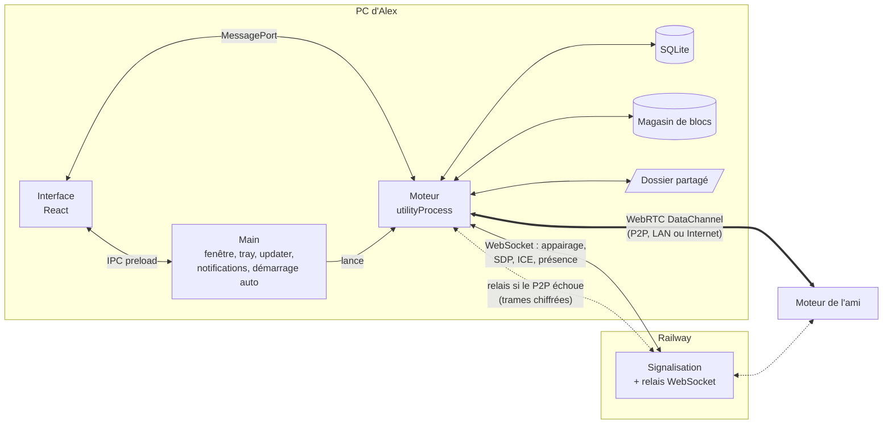
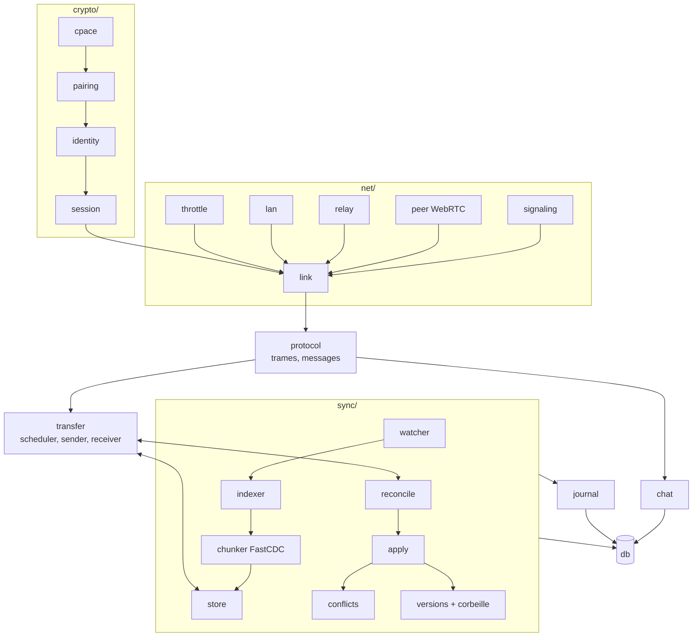
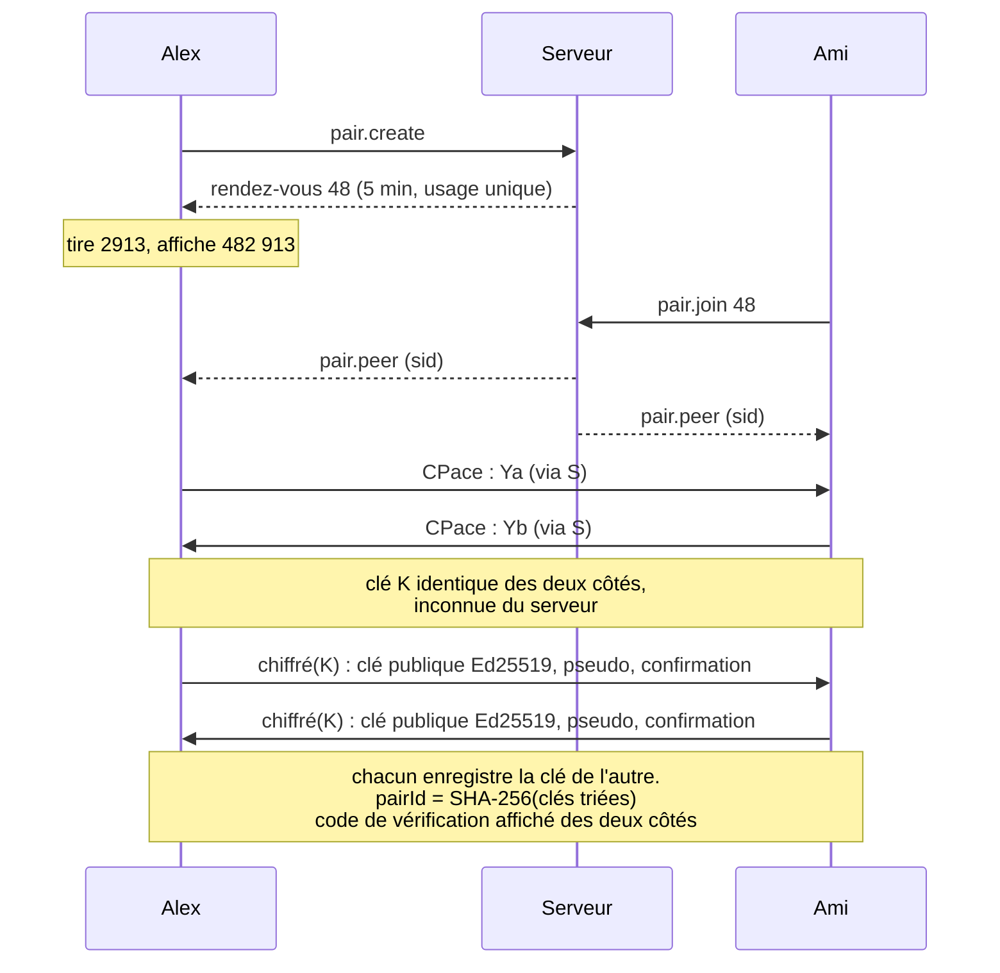
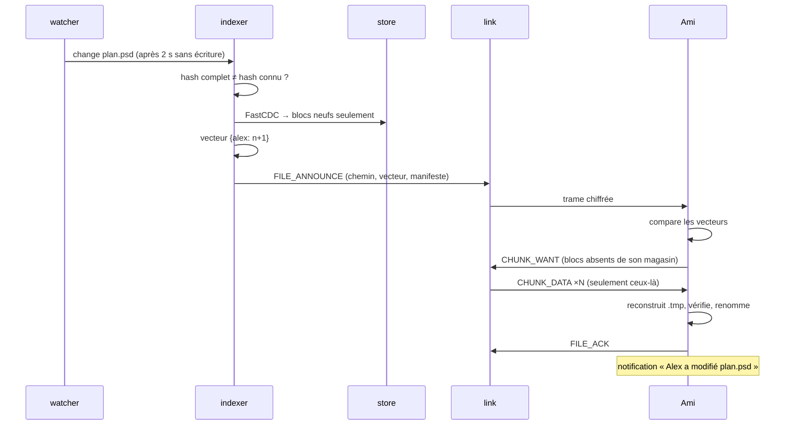
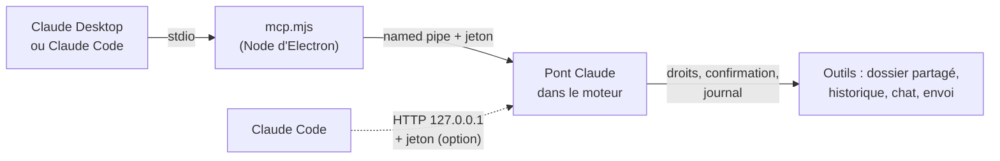

# Architecture

Nom provisoire : **Binôme**. Application de bureau Windows qui garde un dossier identique chez deux personnes et permet de s'envoyer des fichiers en direct.

## 1. Choix de la stack

**Electron, pas Tauri.**

| Critère | Electron | Tauri |
|---|---|---|
| Logique fichiers | Node, chokidar, `fs`, `crypto` natif | Rust à écrire, pas de chokidar |
| WebRTC hors interface | `node-datachannel` (libdatachannel, N-API, binaires précompilés) | `webrtc-rs`, moins mûr |
| Mises à jour | `electron-updater` + GitHub Releases, éprouvé | plugin updater, fonctionne, signature obligatoire |
| Taille de l'installeur | ~90 Mo | ~10 Mo |
| Mémoire | ~150 Mo | ~50 Mo |

Tauri gagne sur le poids. Pour deux utilisateurs, ça ne compte pas. Electron gagne sur tout ce qui fait le cœur de l'app : fichiers, réseau, mises à jour, et tout s'écrit en TypeScript.

Autres choix :

- **electron-vite** pour builder main, preload, moteur et interface.
- **node:sqlite** (intégré à Node et à Electron) pour l'index, l'historique, le chat et le journal. Pas de module natif à recompiler, contrairement à better-sqlite3.
- **node-datachannel** pour WebRTC dans le moteur, pas dans l'interface : les octets ne passent pas par l'IPC.
- **@noble/curves** pour l'appairage (CPace). Le reste du chiffrement vient de `node:crypto` (X25519, Ed25519, AES-256-GCM, HKDF, SHA-256). Pas de ChaCha20 : la build Node d'Electron (BoringSSL) ne l'expose pas.
- **ws** pour le serveur de signalisation.

## 2. Processus



- **Main** : fenêtre, icône de la barre des tâches, notifications Windows, `electron-updater`, lancement au démarrage, protocole `binome://` pour les aperçus. Il ne touche pas aux fichiers synchronisés.
- **Moteur** (`utilityProcess`) : tout le travail lent. Surveillance du dossier, découpage, hash, base de données, réseau, chiffrement. Un plantage du moteur ne fige pas l'interface ; le main le relance.
- **Interface** : React. Parle au moteur par un `MessagePort` direct (état, progression, commandes) et au main par le preload (fenêtre, mises à jour, choix de dossier).
- **Serveur Railway** : un seul service Node. Il crée les codes d'appairage, met les deux pairs en relation, relaie SDP et ICE, signale la présence, et sert de relais de données quand le P2P échoue. Il ne voit que des trames chiffrées.

## 3. Modules du moteur



| Module | Rôle |
|---|---|
| `net/signaling` | Connexion WebSocket au serveur, reconnexion, présence |
| `net/peer` | `RTCPeerConnection` via node-datachannel, deux canaux : `control` (fiable, ordonné) et `data` (fiable, non ordonné) |
| `net/relay` | Même interface que `peer`, mais les trames passent par le serveur |
| `net/lan` | Découverte sur le réseau local et canal TCP direct (étape LAN) |
| `net/link` | Choisit le transport disponible le plus rapide, bascule sans perdre l'état |
| `net/throttle` | Seau à jetons pour la limite de bande passante |
| `crypto/cpace` | Échange de clé authentifié par les 4 chiffres secrets du code |
| `crypto/identity` | Paire de clés Ed25519 de l'appareil, clé publique de l'ami |
| `crypto/session` | Clés de session par connexion, chiffrement de chaque trame |
| `sync/watcher` | chokidar sur le dossier partagé, filtre les fichiers temporaires et nos propres écritures |
| `sync/indexer` | Table `chemin → hash, taille, vecteur de version` |
| `sync/chunker` | Découpage FastCDC, blocs de 16 à 256 Kio (64 Kio en moyenne), SHA-256 par bloc |
| `sync/store` | Blocs adressés par leur hash, rangés dans des fichiers pack, index dans SQLite |
| `sync/reconcile` | Compare les deux index à la connexion et après chaque changement |
| `sync/apply` | Reconstruit un fichier dans un `.tmp`, vérifie le hash complet, renomme |
| `sync/conflicts` | Détecte les modifications concurrentes, crée `fichier.conflit-pseudo.ext` |
| `sync/versions` | 10 versions par fichier, corbeille de 30 jours, restauration |
| `transfer/*` | File d'attente, priorités (envoi direct d'abord), reprise, progression |
| `chat`, `journal`, `db` | Messages, historique des actions, schéma SQLite |

## 4. Appairage et chiffrement

Le code à 6 chiffres n'a que 20 bits d'entropie. L'envoyer tel quel ou en tirer une clé par hash laisserait le serveur tester le million de codes hors ligne. On utilise donc **CPace**, un échange de clé authentifié par mot de passe : un attaquant actif n'a droit qu'à un essai par code, et le code expire après une tentative ou 5 minutes.

Le code se coupe en deux, comme dans magic-wormhole :

- les **2 premiers chiffres** (attribués par le serveur) servent au rendez-vous. Le serveur les connaît ;
- les **4 derniers** (tirés par l'app) servent de mot de passe CPace. Ils ne quittent jamais les deux PC.

Un serveur malhonnête a donc 1 chance sur 10 000 de s'interposer, et un essai raté fait échouer l'appairage de façon visible. Pour l'exclure tout à fait, les deux écrans affichent ensuite un code de vérification de 8 chiffres à comparer de vive voix : il diffère si quelqu'un s'est interposé.



Connexions suivantes :

1. Chaque moteur se connecte au serveur, envoie sa clé publique et celle de l'ami, et signe un défi du serveur. Le serveur recalcule le `pairId` à partir des deux clés : il ne stocke rien et ne relie que les deux détenteurs des clés.
2. Les offres SDP sont signées avec la clé Ed25519. Le serveur ne peut pas substituer son empreinte DTLS.
3. Sur le canal ouvert, échange X25519 éphémère signé → clés de session (HKDF), une par sens.
4. Chaque trame est chiffrée en AES-256-GCM avec un compteur comme nonce. Même format sur WebRTC, relais et LAN : le relais ne voit que du bruit, et on n'a qu'un seul chemin de code à auditer.

## 5. Flux de synchronisation

### Modèle

- Un fichier = un **manifeste** : liste ordonnée de `(hash, taille)` de ses blocs, plus le hash du fichier entier.
- Chaque fichier porte un **vecteur de version** à deux compteurs `{alex: n, ami: m}`. Pas d'horodatage : les horloges des deux PC divergent.
- Une suppression est une **pierre tombale** (version + date). Elle sert aussi d'entrée de corbeille pendant 30 jours.

### Modification locale



Le destinataire ne demande que les blocs qu'il n'a pas. Il a déjà les blocs de l'ancienne version dans son magasin, donc une retouche locale dans un PSD de 500 Mo ne transfère que quelques Mo. Un fichier renommé ou copié ne transfère rien.

### Décision à la réception

| Vecteur reçu vs local | Action |
|---|---|
| Reçu domine (plus récent) | Appliquer, l'ancienne version passe dans l'historique |
| Local domine | Ignorer, renvoyer notre version |
| Égaux | Rien |
| Concurrents | Conflit : la version locale reste, la version reçue est écrite en `plan.conflit-ami.psd`, notification |

### À la reconnexion

Échange des index complets (`chemin → vecteur, hash, supprimé`), puis la même table de décision fichier par fichier. Les modifications faites hors ligne passent par là.

### Envoi direct

Glisser un fichier dans l'app : même manifeste et mêmes blocs, mais destination `Téléchargements\Binôme` chez l'ami (réglable), priorité haute, pas de synchro en retour.

## 6. Magasin de blocs, historique, corbeille

- Les blocs des **10 dernières versions** de chaque fichier et des fichiers de la corbeille restent dans le magasin. Restaurer = reconstruire depuis un manifeste, sans réseau.
- Les blocs sont rangés dans des fichiers pack de 64 Mo (comme restic ou git) plutôt qu'un fichier par bloc : NTFS supporte mal des centaines de milliers de petits fichiers.
- Un ramasse-miettes compte les références et réécrit les packs à moitié vides.
- **Coût disque** : le magasin contient au moins une copie de tout le dossier, plus les versions. Un plafond réglable (20 Go par défaut) supprime les versions les plus anciennes en premier.

## 7. Transports

1. **WebRTC** est tenté d'abord. ICE essaie les adresses locales, puis les adresses publiques via STUN. Sur le même Wi-Fi, il trouve la route locale tout seul.
2. **Relais WebSocket** si ICE échoue après 10 s. Railway n'expose pas d'UDP public, seulement HTTP et un proxy TCP : un serveur TURN (coturn) y serait bancal. Le relais passe donc par le WebSocket déjà ouvert. Le moteur réessaie le P2P toutes les 2 minutes et bascule dès qu'il marche.
3. **LAN direct** : découverte par diffusion UDP sur le réseau local, puis connexion TCP chiffrée avec les mêmes clés. Le DataChannel passe par SCTP sur DTLS, dont le débit est souvent bien inférieur à celui d'un réseau gigabit. À mesurer à l'étape LAN avant de garder ce canal.

### État à l'étape 3

- Un seul DataChannel fiable et ordonné porte les messages de contrôle et les données. Le second canal non ordonné viendra si les mesures le justifient.
- L'envoi direct transmet le fichier en flux, avec reprise à l'octet près depuis le `.part` du destinataire. Il passera aux blocs et manifestes avec le moteur de synchro (étape 5).
- Débit mesuré entre deux instances sur le même PC : environ 33 Mo/s en WebRTC. C'est la limite de SCTP dans libdatachannel, et la raison du canal TCP du mode LAN (étape 8).
- L'état des transferts vit en mémoire : un redémarrage de l'app perd la reprise.

### État à l'étape 5

- Le moteur de synchro tient dans `sync/` : [sync.ts](../apps/desktop/src/engine/sync/sync.ts) (protocole, décision, téléchargement, reconstruction), `chunker.ts` (FastCDC, ~340 Mo/s), `store.ts` (packs de 64 Mo), `files.ts` (index), `vv.ts`, `paths.ts`, `lock.ts` (un verrou par chemin entre indexation et application).
- La synchro reprend d'elle-même après une coupure ou un redémarrage : les blocs reçus sont dans le magasin, seuls les manquants sont redemandés.
- Conflit : la version la plus récente chez son auteur garde le nom, l'autre devient `nom.conflit-auteur.ext`. Les deux côtés appliquent la même règle et convergent sans échange supplémentaire.
- Les fichiers temporaires de reconstruction vont dans `.binome/tmp` à la racine du dossier partagé (ignoré par la synchro), sur le même disque pour que le renommage final soit instantané.
- Un fichier ouvert ailleurs (Photoshop, antivirus) : quelques essais rapprochés, puis un nouvel essai toutes les 5 s.
- Réanalyse discrète du dossier toutes les 10 minutes : sous forte activité, Windows peut perdre des événements de surveillance.
- Pas encore fait : les dossiers vides ne sont pas synchronisés ; l'envoi direct reste en flux, sans passer par le magasin.

### État à l'étape 6

- Table `versions` : chaque changement (local, reçu, suppression) ajoute une ligne, 10 gardées par fichier ([history.ts](../apps/desktop/src/engine/sync/history.ts)). Restaurer reconstruit la version depuis le magasin, sans réseau, puis l'indexe comme une modification locale : elle part chez l'autre avec un vecteur de version qui domine.
- Corbeille : un fichier supprimé garde sa dernière version 30 jours. Après, ses versions sont oubliées et ses blocs libérés.
- Conflits : enregistrés des deux côtés (table `conflicts`), affichés dans Fichiers jusqu'à « J'ai vu », avec une notification Windows.
- Ramasse-miettes 1 min après le démarrage puis toutes les heures : expiration de la corbeille, plafond (20 Go par défaut, réglable), suppression des blocs orphelins de plus d'une heure, réécriture des packs remplis à moins de moitié.
- Plafond : on supprime d'abord les versions anciennes les plus vieilles. La version actuelle d'un fichier n'est jamais touchée, même si le dossier seul dépasse le plafond.
- Les requêtes de l'interface (journal, versions, corbeille, restaurer) passent par le MessagePort avec un identifiant et une réponse ; l'état poussé ne contient qu'un compteur `revision` pour savoir quand recharger.

### État à l'étape 7

- Direction visuelle (skill unslop) : proche, discret, exact ; univers du papier carbone. Rampe graphite, une seule couleur vive (bleu encre `#4a86ff`) pour le trait de liaison, la progression, la sélection et les non-lus. Inter et JetBrains Mono, intégrées au bundle.
- Signature : deux points reliés. Logo, présence, carte de liaison en tête de Fichiers (le trait se remplit pendant un transfert), statut des messages du chat.
- Chat : table `chat` dans `app.sqlite`, file d'attente hors ligne, dédoublonnage par identifiant, accusé de réception. Un message peut citer un fichier du dossier partagé.
- Aperçus : protocole `binome://shared/…` et `binome://inbox/…` servi par le main ([preview.ts](../apps/desktop/src/main/preview.ts)), limité à ces deux racines, avec plages d'octets pour les vidéos et CORS pour `fetch`.
- Icône près de l'horloge ([tray.ts](../apps/desktop/src/main/tray.ts)) ; fermer la fenêtre la cache. Lancement au démarrage activé par défaut dans l'app installée, avec `--hidden`.
- Le moteur envoie au main deux résumés : `folder` (racine des aperçus) et `status` (info-bulle de l'icône).

### État à l'étape 8 : connexion avec Claude



- `mcp.mjs` ([server.ts](../apps/desktop/src/claude/server.ts)) est lancé par Claude avec `ELECTRON_RUN_AS_NODE=1 Binome.exe`. Il ne lit rien lui-même : chaque appel passe par un named pipe propre au profil ([pipe.ts](../apps/desktop/src/claude/pipe.ts)), avec un jeton lu dans les données de l'app (`claude-token`), que seul le compte Windows de l'utilisateur peut lire.
- Le pont ([claude.ts](../apps/desktop/src/engine/claude.ts)) vérifie le jeton, l'autorisation globale et le droit de l'outil, puis journalise dans `claude_log` (app.sqlite, 1 000 dernières actions).
- Les outils ([claude-tools.ts](../apps/desktop/src/engine/claude-tools.ts)) n'acceptent que des chemins relatifs au dossier partagé, validés comme ceux reçus de l'autre PC. `restore_version` et `send_file` hors du dossier passent par une confirmation dans l'app (refus sans réponse en 2 minutes).
- « via Claude » : colonne `via` dans `versions`, `files` et `chat`. Le champ `c` des entrées de synchro et `via` des messages de chat le portent chez l'autre.
- Le serveur est construit en `.mjs` et sorti de l'archive asar : Claude le lance hors de l'app, loin du `package.json` qui déclare l'ESM.

### État à l'étape 10 : profil, wizz, plantages, bêta

- Protocole pair à pair en version 2. Un type de message inconnu est ignoré par l'autre côté : une app plus ancienne reste compatible, elle ne voit simplement ni profil ni wizz. `hello` porte aussi la version de l'app (`app`), affichée chez l'autre dans Paramètres.
- Profil ([profile.ts](../apps/desktop/src/engine/profile.ts)) : statut (`available`, `busy`, `away` et un texte de 60 caractères), avatar JPEG de 128 px recadré par le main (48 Kio au plus, signature d'image vérifiée). Envoyé à chaque ouverture du canal ; une image identique n'est pas réécrite. Les avatars sont des fichiers du dossier de données servis par `binome://avatar/me` et `/peer` : l'état poussé ne porte qu'un numéro de révision.
- Wizz : un message `wizz`, 1 toutes les 10 s au plus de chaque côté. Le main secoue la fenêtre (ou la notification si elle est cachée), l'interface secoue son contenu et bourdonne (son synthétisé). Statut « Occupé » : reçu sans secousse ni son. Une ligne est notée dans le fil du chat des deux côtés (`chat.kind`), sans compter comme non lu.
- Plantages ([crashes.ts](../apps/desktop/src/engine/crashes.ts)) : le main garde la fin des sorties du moteur (`stdio: 'pipe'`) et des erreurs de l'interface ; arrêt anormal du moteur, `render-process-gone`, erreur React attrapée, exception non gérée du main. Le rapport (16 000 derniers caractères) passe au moteur par une commande du main (`type: 'command'`), qui l'enregistre dans `crashes` (app.sqlite) et l'envoie comme le chat : file d'attente, accusé, dédoublonnage. 5 rapports par type et par 10 minutes au plus.
- Garde-fou des mises à jour ([update-guard.ts](../apps/desktop/src/main/update-guard.ts), logique pure et testée) : versions lancées, versions saines (5 minutes sans boucle de plantages), fermetures normales, versions mises de côté, dans `updates.json`.

## 8. Mises à jour

- `electron-builder` produit un installeur NSIS par utilisateur (`Binome-Setup-X.Y.Z.exe`, nom ASCII) et `latest.yml`. Le dépôt de publication vient de `GITHUB_REPOSITORY` : rien n'est codé en dur.
- À chaque tag `vX.Y.Z`, GitHub Actions lance les tests (Node et Node d'Electron), fixe la version depuis le tag, construit et publie la release.
- `electron-updater` (main, [updater.ts](../apps/desktop/src/main/updater.ts)) vérifie 10 s après le lancement puis toutes les 4 heures, télécharge en arrière-plan et envoie l'état à l'interface. Le bouton Redémarrer appelle `quitAndInstall` ; le moteur est arrêté proprement par `before-quit`.
- Téléchargement à la main (`autoDownload = false`) : une version mise de côté après un retour en arrière n'est pas retéléchargée.
- Canal bêta : `allowPrerelease`. Un tag `vX.Y.Z-beta.N` produit une préversion et `beta.yml` (canal déduit de la version par electron-builder) ; le canal stable lit `/releases/latest`, qui ignore les préversions. `allowDowngrade` reste faux.
- Retour en arrière : flux `generic` pointé sur `https://github.com/<dépôt>/releases/download/v<version>/` (dépôt lu dans `app-update.yml`), `latest.yml` ou `beta.yml` selon la version, `allowDowngrade` pour ce seul téléchargement, puis `quitAndInstall`. En cas d'échec, retour au flux GitHub.
- Seuls `node-datachannel`, `ws` et `electron-updater` sont empaquetés. Tout le reste est intégré au bundle par Vite. Le module natif est sorti de l'archive asar (`asarUnpack`).

## 9. Arborescence

```
binome/
├─ package.json                 workspaces npm
├─ README.md
├─ docs/
│  └─ ARCHITECTURE.md
├─ .github/workflows/
│  └─ release.yml               build + release à chaque tag v*
├─ packages/
│  └─ protocol/                 partagé entre l'app et le serveur
│     └─ src/
│        ├─ messages.ts         types des messages de contrôle
│        ├─ frames.ts           format binaire des trames
│        └─ signaling.ts        messages client ↔ serveur
├─ apps/
│  ├─ signaling/                serveur Railway
│  │  ├─ package.json
│  │  ├─ Dockerfile
│  │  └─ src/
│  │     ├─ index.ts            HTTP + WebSocket
│  │     ├─ pairing.ts          codes, expiration, limite d'essais
│  │     ├─ rooms.ts            pairId → deux sockets, présence
│  │     └─ relay.ts            transfert de trames opaques
│  └─ desktop/
│     ├─ package.json
│     ├─ electron.vite.config.ts
│     ├─ electron-builder.yml
│     ├─ resources/             icon.ico, icônes du tray
│     └─ src/
│        ├─ main/
│        │  ├─ index.ts
│        │  ├─ window.ts
│        │  ├─ tray.ts
│        │  ├─ updater.ts
│        │  ├─ notifications.ts
│        │  ├─ autostart.ts
│        │  ├─ preview-protocol.ts
│        │  └─ engine-host.ts   lance le moteur, relie le MessagePort
│        ├─ preload/
│        │  └─ index.ts
│        ├─ claude/            serveur MCP (stdio), canal local, définition des outils
│        ├─ engine/
│        │  ├─ index.ts
│        │  ├─ api.ts           commandes et événements exposés à l'interface
│        │  ├─ net/             signaling, peer, relay, lan, link, throttle
│        │  ├─ crypto/          cpace, identity, session
│        │  ├─ pairing/
│        │  ├─ sync/            watcher, indexer, chunker, store, reconcile,
│        │  │                   apply, conflicts, versions
│        │  ├─ transfer/        scheduler, sender, receiver
│        │  ├─ chat.ts
│        │  ├─ journal.ts
│        │  └─ db/              schema.sql, migrations, index.ts
│        └─ renderer/
│           ├─ index.html
│           └─ src/
│              ├─ main.tsx
│              ├─ App.tsx
│              ├─ lib/engine.ts  client typé du moteur
│              ├─ styles/tokens.css
│              ├─ components/
│              └─ views/         Files, Transfers, History, Chat, Settings, Pairing
└─ tests/                       tests du moteur (deux moteurs en local)
```

## 10. Points difficiles

### NAT

- **NAT symétrique et CGNAT** (box 4G/5G, certains opérateurs fibre) : le P2P échoue souvent. Le relais doit être fiable dès le départ, pas un ajout.
- **Changement de réseau** (Wi-Fi → partage de connexion) : la connexion meurt sans erreur nette. Battement de cœur toutes les 5 s, redémarrage ICE après 15 s de silence.
- **Pare-feu Windows** : l'écoute TCP du mode LAN déclenche une alerte à la première ouverture. L'installeur NSIS ajoutera une règle.
- **Coût du relais** : Railway facture le trafic sortant. Un gros dossier synchronisé via relais coûte de l'argent, d'où la relance régulière du P2P et l'affichage du transport utilisé.

### Conflits

- **Écho** : quand le moteur écrit un fichier reçu, chokidar le voit comme une modification locale. On garde le hash attendu et on ignore l'événement s'il correspond.
- **Enregistrements atomiques** : Photoshop, Office et VS Code écrivent un temporaire puis renomment. On ignore `~$*`, `*.tmp`, `.~lock*` et on attend 2 s de calme avant d'indexer.
- **Fichiers verrouillés** : un fichier ouvert dans Photoshop ne peut pas être remplacé (`EBUSY`). La version reçue attend, avec un état « en attente, fichier ouvert » et une nouvelle tentative.
- **Casse et noms Windows** : `Plan.psd` et `plan.psd` sont le même fichier sous NTFS. Chemins de plus de 260 caractères, noms interdits (`CON`, `NUL`...). L'index compare en minuscules.
- **Dossiers** : supprimer un dossier côté A pendant que B y ajoute un fichier. Le fichier ajouté gagne, le dossier est recréé.

### Gros fichiers

- **Mémoire** : tout passe en flux. Jamais de fichier entier en RAM, ni côté hash ni côté envoi.
- **Temps de hash** : SHA-256 tourne vers 1 à 2 Go/s sur un CPU récent, la lecture disque limite plus. Un fichier de 50 Go prend une minute avant le premier octet envoyé. L'indexation tourne en tâche de fond avec une progression visible.
- **Contre-pression** : node-datachannel accepte tout ce qu'on lui donne et bufferise. On attend `bufferedAmountLow` avant d'envoyer la suite, sinon la mémoire explose. Trames de 64 Kio au maximum (limite de message SCTP).
- **Reprise** : naturelle avec les blocs. Les blocs reçus sont dans le magasin, la reprise ne redemande que les manquants.
- **Espace disque** : la reconstruction a besoin de la taille du fichier en plus. On vérifie l'espace libre avant de commencer.
- **Fichier modifié pendant l'envoi** : le manifeste annoncé n'est plus valide. Le destinataire vérifie chaque bloc ; à la première erreur, l'émetteur réindexe et réannonce.

### Mises à jour

- **Sans signature de code**, Windows SmartScreen affiche un avertissement à l'installation. Les mises à jour suivantes passent quand même. Signer demande un certificat payant (Azure Trusted Signing ou certificat OV), optionnel pour deux utilisateurs.
- **Dépôt privé** : `electron-updater` aurait besoin d'un jeton GitHub embarqué dans l'app. Le plus simple est un dépôt public, ou un second dépôt public qui ne contient que les releases.

## 11. Étapes

1. Architecture (ce document)
2. Monorepo, serveur de signalisation, appairage CPace
3. Lien P2P chiffré, relais de secours, envoi direct d'un fichier avec progression
4. `electron-updater` et workflow GitHub Actions
5. Moteur de synchro : watcher, index, FastCDC, magasin, réconciliation
6. Historique, corbeille, conflits
7. Interface complète, chat, aperçus, journal, notifications, tray, démarrage auto
8. Mode LAN, limite de bande passante, durcissement de la reprise
